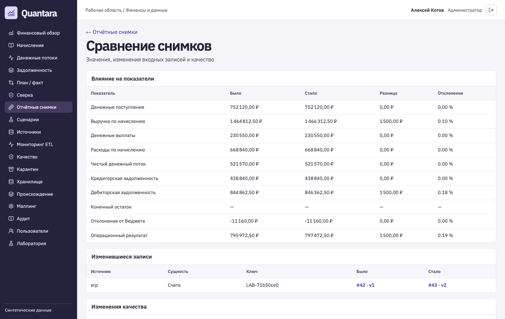

# Quantara · Financial data and reproducible reports

[Русский](README.ru.md) · [English](README.en.md)

Quantara explains which source versions produced a financial metric and why it changed after a correction. All invoices, bank statements, budgets and exchange rates are synthetic.

## Run locally

```sh
docker compose up --build --wait
```

Open [Quantara](http://127.0.0.1:8150). First boot applies migrations, imports the June 2026 sample and builds its snapshot. The local demonstration password is `Quantara-local-demo`. See `.env.example` for the port and initial password.

| Login | Workspace |
| --- | --- |
| `finance` | Reports, KPIs, reconciliation and scenarios |
| `analyst` | Reports, lineage, quality and warehouse |
| `engineer` | ETL, CSV import and reprocessing |
| `steward` | Quarantine, quality and mapping versions |
| `admin` | Users, audit and the isolated Lab |

## Financial method

Accrued revenue and expenses use ERP invoices. Cash inflows and outflows use bank value dates. A RUB 400,000 payment on a RUB 1,000,000 invoice produces RUB 1,000,000 in revenue, RUB 400,000 in inflow, and RUB 600,000 open. A refund increases the open amount. Each conversion uses its event date's exact FX rate and precise decimal arithmetic. Missing rates or records can make a total unknown while retaining the known subtotal.

Marts expose accrual, cash flow and balances, AR/AP, revenue and expense breakdowns, and budget comparison. Reconciliation links documents through explicit references and recomputes the bank statement balance. Unidentified payments remain visible. Scenario values are hypothetical calculations based on stored reports.

## Data flow

Three independent FastAPI services with separate SQLite volumes expose ERP, bank, and FX feeds over REST. PostgreSQL stores immutable raw deliveries, staging, typed facts, quality results and snapshots. ETL uses delivery sequences, a PostgreSQL lock, and a single publication transaction. Reprocessing uses saved raw records. React and TypeScript run behind nginx.

[Method and requirements](docs/design.md) · [Data model](docs/diagrams/warehouse.mmd) · [ETL](docs/diagrams/etl.mmd) · [Lineage](docs/diagrams/lineage.mmd)

[OpenAPI](docs/openapi.json) · [ERP API](docs/erp-openapi.json) · [Bank API](docs/bank-openapi.json) · [FX API](docs/fx-openapi.json) · [Local Swagger UI](http://127.0.0.1:8150/api/docs)

`backend/` contains application modules, SQL and Alembic. `sources/` contains the simulators. `frontend/` contains React, Vite and Playwright. `scripts/`, `tests/` and `docs/` contain verification and design evidence.

## Lab, security and limits

```sh
scripts/lab up
```

Open [Quantara Lab](http://127.0.0.1:8151) as `admin`. Lab runs against its own volumes and shows actual responses and evidence. `scripts/lab reset` recreates only lab data. The server checks roles, hashes passwords with Argon2, and connects to fixed source hostnames. Compose publishes the workspace on loopback.

[Verification and traceability](docs/verification.md) · [GitHub Actions](https://github.com/bivaettttt/quantara/actions) · [Status and limitations](docs/PROJECT_STATUS.md)

This project implements an educational reporting method. Project source licensing is pending. Third-party components retain their upstream licenses.

## Demonstration



[Walkthrough, screenshots and video](docs/demo.md) · [Portfolio case study](docs/portfolio.md)
