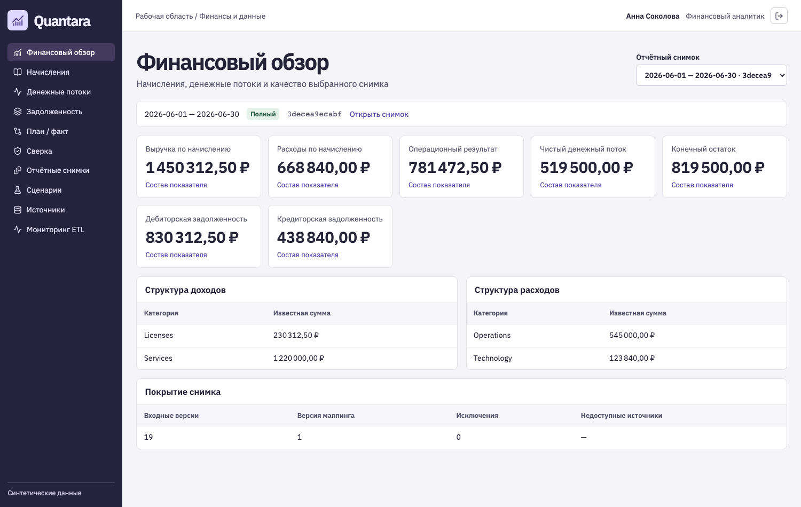

# Quantara

Quantara is an educational financial analytics platform. It brings ERP, banking and FX data into PostgreSQL and traces reproducible reports back to independent source deliveries.

Quantara объединяет синтетические данные ERP, банка и валютных курсов. Каждый отчётный снимок сохраняет состав входных версий и происхождение показателей.

[Русский](README.ru.md) · [English](README.en.md) · [OpenAPI](docs/openapi.json) · [Проверки / Verification](docs/verification.md)

```sh
docker compose up --build --wait
```

[Рабочая область / Workspace](http://127.0.0.1:8150)



[Демонстрация / Walkthrough](docs/demo.md)
