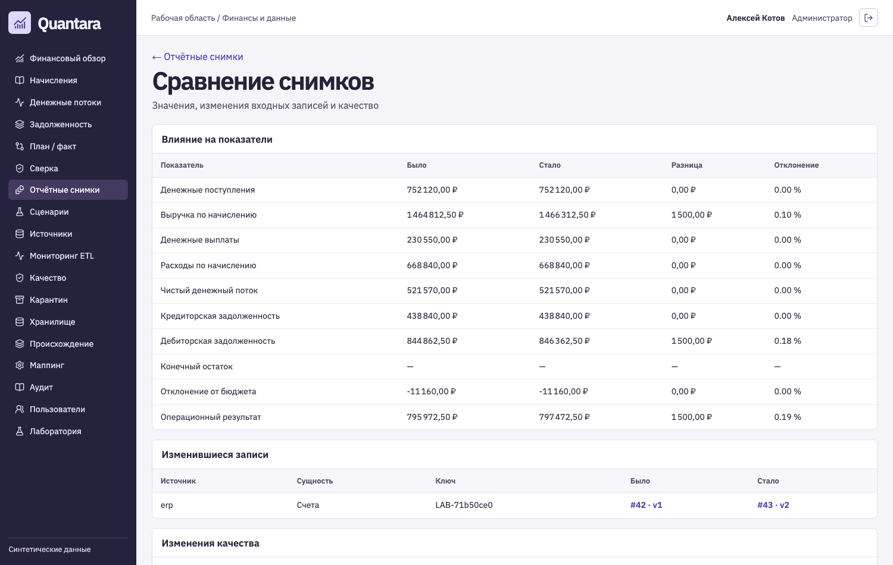

# Quantara · Финансовые данные и воспроизводимые отчёты

[Русский](README.ru.md) · [English](README.en.md)

Quantara показывает, какие версии первичных данных сформировали финансовый показатель и почему отчёт изменился после корректировки. В системе используются только синтетические счета, выписки, бюджеты и валютные курсы.

## Запуск

```sh
docker compose up --build --wait
```

Откройте [Quantara](http://127.0.0.1:8150). При первом старте применяются миграции, загружается учебный набор за июнь 2026 года и формируется снимок. Локальный демонстрационный пароль — `Quantara-local-demo`. `.env.example` задаёт переменные порта и первоначального пароля.

| Логин | Доступ |
| --- | --- |
| `finance` | Отчёты, KPI, сверка, сценарии |
| `analyst` | Отчёты, происхождение, качество и хранилище |
| `engineer` | ETL, импорт CSV, повторная обработка |
| `steward` | Карантин, качество и версии маппинга |
| `admin` | Пользователи, аудит и изолированная Lab |

## Финансовая методология

Выручка и расходы используют счета ERP по начислению. Поступления и выплаты используют даты банковских операций. Платёж на 400 000 ₽ по счёту на 1 000 000 ₽ даёт 1 000 000 ₽ выручки, 400 000 ₽ поступлений и 600 000 ₽ открытой суммы. Возврат увеличивает открытую сумму. Для каждой конвертации используется курс даты операции, а денежные суммы хранятся и вычисляются точно. Отсутствующий курс или запись могут оставить значение неизвестным с указанием известной части.

Витрины показывают начисления, денежный поток и остаток, AR/AP, структуру доходов и расходов, план-факт. Сверка сопоставляет документы по явной ссылке и пересчитывает остаток выписки. Незнакомые платежи остаются в списке расхождений. Сценарий рассчитывает гипотезу на основе сохранённого снимка.

## Поток данных

Три независимых FastAPI-сервиса с отдельными томами SQLite поставляют ERP, банковские выписки и FX по REST. PostgreSQL хранит неизменяемые raw-записи, staging, типизированные факты, результаты проверок и снимки. ETL использует последовательности доставки, PostgreSQL-блокировку и одну транзакцию публикации. Переобработка использует сохранённый raw. React и TypeScript работают через nginx.

[Методология и требования](docs/design.md) · [Модель данных](docs/diagrams/warehouse.mmd) · [ETL](docs/diagrams/etl.mmd) · [Lineage](docs/diagrams/lineage.mmd)

[OpenAPI](docs/openapi.json) · [ERP API](docs/erp-openapi.json) · [Bank API](docs/bank-openapi.json) · [FX API](docs/fx-openapi.json) · [Локальный Swagger UI](http://127.0.0.1:8150/api/docs)

`backend/` содержит модули, SQL и Alembic. `sources/` содержит симуляторы. `frontend/` содержит React, Vite и Playwright. `scripts/`, `tests/`, `docs/` содержат проверки и проектные артефакты.

## Lab, безопасность и границы

```sh
scripts/lab up
```

Откройте [Quantara Lab](http://127.0.0.1:8151) под `admin`. Lab использует собственные тома, журналы и фактические ответы. Команда `scripts/lab reset` пересоздаёт только данные лаборатории. Сервер проверяет роли, хеширует пароли Argon2, обращается к исходным сервисам по фиксированным адресам. Интерфейс Compose доступен на loopback.

[Проверки и трассируемость](docs/verification.md) · [GitHub Actions](https://github.com/bivaettttt/quantara/actions) · [Статус и ограничения](docs/PROJECT_STATUS.md)

Проект использует учебную методологию. Лицензия собственных исходников пока не назначена. Сторонние библиотеки сохраняют свои лицензии.

## Демонстрация



[Сценарий показа, скриншоты и видео](docs/demo.md) · [Материал для портфолио](docs/portfolio.md)
